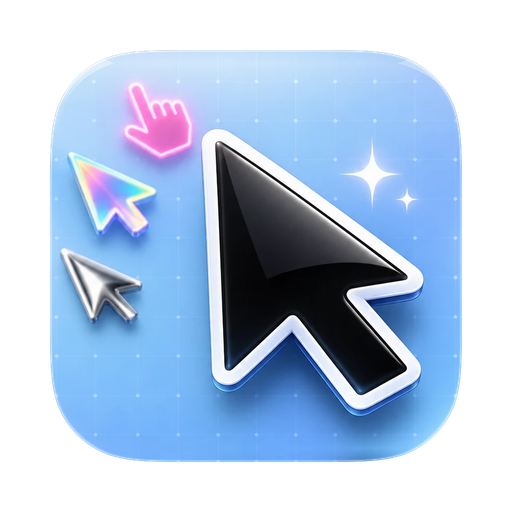
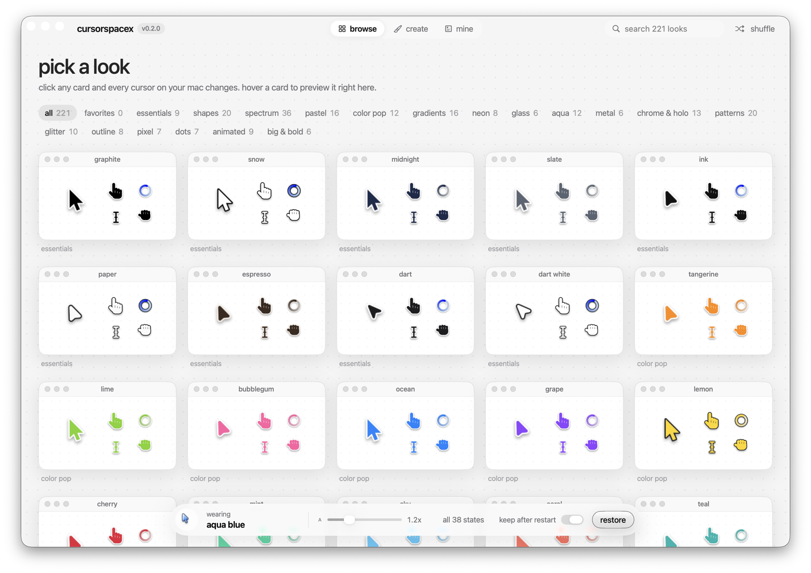
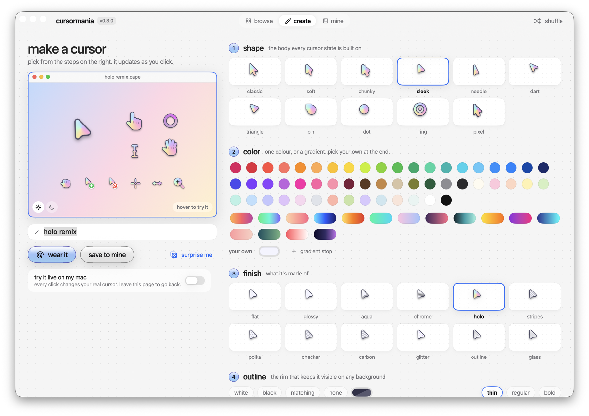

<p align="center"></p>
<h1 align="center">cursormania</h1>
<p align="center">every cursor on your mac, restyled.<br>220+ looks, all 38 cursor states, one click, or make your own in seven clicks. native swift, free and open source.</p>
<p align="center"><a href="https://csx.lou15.com"><b>csx.lou15.com</b></a></p>

<p align="center"></p>
<p align="center"></p>

## install

macOS 26 (Tahoe) or newer, Apple silicon or Intel. Paste this into Terminal:

```bash
curl -fsSL https://csx.lou15.com/install.sh | bash
```

It downloads the latest release from this repo, copies it to `/Applications` (your password is asked once), clears the download quarantine flag and opens the app. The app is ad-hoc signed, not notarized, which is why it installs this way. [Read the script](install.sh) first if you like.

By hand: download `CursorMania.zip` from the [latest release](https://github.com/Louistuis/cursormania/releases/latest), drag the app to Applications, then press "Open Anyway" in System Settings > Privacy & Security.

Uninstall (puts the stock cursor back, removes the app and its settings):

```bash
curl -fsSL https://csx.lou15.com/install.sh | bash -s uninstall
```

## what it does

- **the real cursor, system-wide.** No overlay window chasing the mouse. cursormania registers its images with WindowServer under the same names macOS uses for its own cursors, so the pointer is as smooth as stock because it is drawn the same way.
- **every state.** Arrow, context menu, help, busy, the wait beachball, text and vertical text, link, open and closed hand, counting hands, copy, alias, move, not allowed, poof, crosshairs, cell, screenshot, zoom, and all eighteen resize edges.
- **221 looks** in essentials, shapes, spectrum, pastel, color pop, gradients, neon, glass, aqua, metal, chrome & holo, patterns, glitter, outline, pixel, dots, animated and big & bold.
- **11 shapes:** classic, soft, chunky, sleek, needle, dart, triangle, pin, dot, ring, pixel.
- **11 finishes:** flat, glossy, aqua, chrome, holo, stripes, polka, checker, carbon, glitter, outline, plus glass.
- **make your own in seven clicks** (shape, colour, finish, outline, glow, motion, size) with a big live preview you can hover, "surprise me", and "try it live on my mac", which wears the draft system-wide while you click. Your looks live in "mine".
- **sticks around:** re-applied at login, after sleep and after a user switch. Size from 0.75x to 2.5x.
- **menu bar switcher** with favorites, shuffle and restore.

## how it works

macOS keeps cursor images in WindowServer. cursormania uses the private SkyLight calls the system itself uses at login (`CGSRegisterCursorWithImages`, `CGSSetRegisteredCursor`, `CoreCursorUnregisterAll`), looked up at runtime so a future macOS that drops them makes the app refuse politely instead of crashing.

Things that matter on macOS 26:

- the arrow and I-beam have new `ArrowS` / `IBeamS` names next to the classic ones, and browsers ask for `com.apple.cursor.0` / `.1`, so each drawing is registered under all of them;
- `CGSRegisterCursorWithImages(cid, name, global, instant, size, hotspot, frames, frameDuration, images, seed)` takes 1x/2x/5x/10x images, animated frames stacked top to bottom, at most 24 frames;
- the pointer on screen only redraws when the app under it sets its cursor again, so after applying, cursormania posts a zero-distance mouse move (only if macOS allows it, otherwise the next real move shows it);
- before the first theme goes on, the stock cursors are saved to `~/Library/Application Support/CursorSpaceX`, because unregistering does not bring back the system's own arrow.

Every look is drawn in code (`Sources/CursorMania/Painter.swift`) from one `CursorStyle`, so a theme is a few numbers and colours, not a folder of images.

## build

Command Line Tools are enough, no Xcode needed.

```bash
./build.sh                  # build/CursorMania.app (universal) + build/CursorMania.zip
```

The binary doubles as a command-line tool:

```bash
CursorMania --list                      # every built-in look
CursorMania --apply neon.neon-pink      # wear one, add --size 1.4 for bigger
CursorMania --restore                   # stock cursor back
CursorMania --verify                    # what WindowServer holds right now
CursorMania --render-catalog out/       # every state of every look as PNG sheets
```

`Tools/shot.sh` screenshots the real window without it appearing on screen, and `site/` is the website (`cd site && npx wrangler@4 deploy`).

## thanks

[Mousecape](https://github.com/alexzielenski/Mousecape) for years of documenting the WindowServer cursor calls, and [MaCursor](https://github.com/writronic/MaCursor) for the Tahoe cursor names.

## licence

MIT. See [LICENSE](LICENSE).
